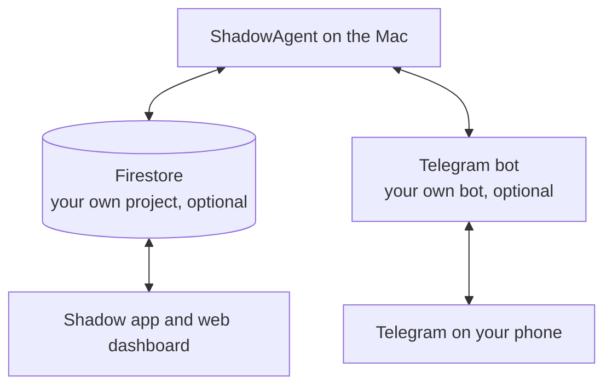

# Mac Shield 🛡️

**Know when someone is trying to break into your MacBook.**

If someone types the wrong password 3 times on your lock screen, Mac Shield alerts your phone. You then choose what happens next: just stay informed, take a photo of the person, or grab your Mac's location.

You can get the alerts in the dedicated **Shadow app**, in a **Telegram bot**, or in both.

> **Status:** working prototype, tested on my own MacBook Air (macOS 27.0.1). Not security audited. See the [limitations](docs/ARCHITECTURE.md#9--limitations).

## What's inside

1. **Shadow Agent** is a small Swift program that runs quietly in the background of your Mac. It watches the system log for failed lock-screen logins.
2. **Shadow app and dashboard** are a mobile app (React Native) and a web dashboard (React) that show alerts and let you send commands.
3. **Telegram bot** is for people who do not want another app. You get real push notifications and can control your Mac from a chat. You can even skip the app and Firebase completely.

## Two ways to use it

Choose with the **Real-Time** switch, in the Shadow app or with `/realtime` in Telegram.

- **Real-Time OFF (default), privacy first.** After 3 wrong passwords you get a text alert. No photo and no location yet. If it looks real, tap **Capture photo**.
- **Real-Time ON, fastest evidence.** After the 3rd wrong password, the agent takes a photo and finds the location straight away, and sends both to you. A few Touch ID misses can also trigger this, which is why OFF is the default.
- **Manual capture, any time.** Tap **Capture photo** in the app or in Telegram whenever you want a photo from your own Mac. The camera light turns on briefly, so it is not secret.

## How it works



1. **ShadowAgent** watches the macOS unified log for failed lock-screen logins.
2. After 3 failures, it sends an alert to Telegram and/or Firestore. With Real-Time OFF, the alert is text only.
3. The alert shows up in your **Telegram** chat as a push notification, or as a card in the **Shadow app** while it is open.
4. From your phone, tap **Capture photo** or **Sound alarm**.
5. The agent on your Mac picks up the command, runs it, and sends the photo and location back.

## Quick start

```bash
git clone https://github.com/ph4ntom-0x/MacShield.git
cd MacShield
cp ShadowAgent/Secrets.swift.example ShadowAgent/Secrets.swift   # then add your keys
./deploy.sh
```

That is the short version. The **[User Guide](docs/USER_GUIDE.md)** covers Firebase, permissions, Telegram and testing step by step.

## Why I built this

This summer, while I was home for the holidays, my 7-year-old cousin tried to unlock my MacBook, probably to watch cartoons. He typed passwords again and again, failed, and eventually decided the next best option was to put the laptop in a bathtub full of water. The MacBook did not survive.

I had no idea any of this was happening. Nothing warned me, and by the time I found out, it was too late. Mac Shield is what I wished I had in that moment: a quick message on my phone saying *"someone is failing to unlock your laptop right now,"* so I could react while it still mattered.

It started as a fix for one bad summer. It turned into a deep dive into macOS internals, background services, code signing and privacy design.

## Documentation

| Read this | If you want to |
|---|---|
| 📖 [User Guide](docs/USER_GUIDE.md) | Install, configure, and connect the Shadow app or the Telegram bot |
| 🏗️ [Architecture](docs/ARCHITECTURE.md) | Understand the code, the data, the security model and the limits |
| 🔐 [TCC Permissions](docs/TCC_PERMISSIONS.md) | See how macOS camera, location and disk permissions were handled |
| 🛠️ [Problems Solved](docs/PROBLEMS_SOLVED.md) | Read the bugs I hit, what caused them, and how I fixed them |
| 💡 [Why Mac Shield](docs/WHY_MACSHIELD.md) | See why I built it and how it compares with other tools |

## Responsible use

Mac Shield is for a computer **you own and control**. It asks for visible system permissions (Camera, Location, Full Disk Access) during setup. Do not install it on someone else's device, and do not use it to watch other people.

## License

This project is licensed under the [MIT License](LICENSE).
