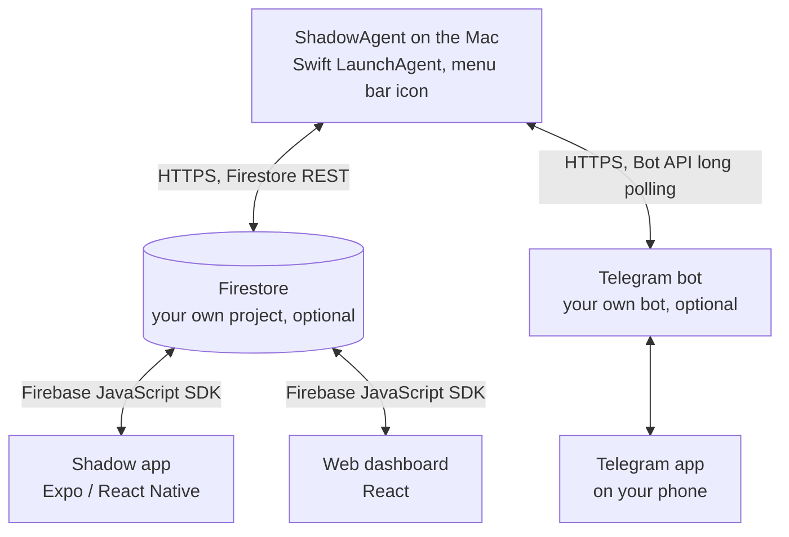
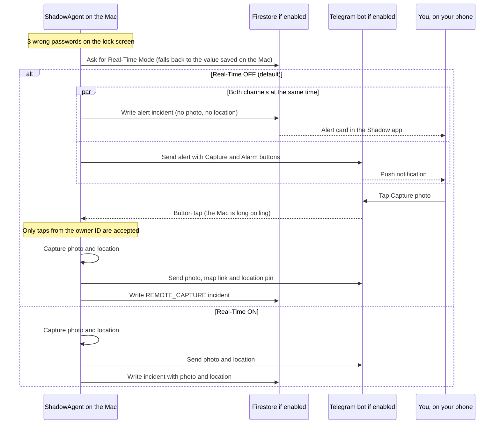

<div align="center">

# 🏗️ Mac Shield · Architecture

**How the pieces fit, why each choice was made, and where it is weak.**

[← Back to README](../README.md) · [User Guide](USER_GUIDE.md) · [TCC Permissions](TCC_PERMISSIONS.md) · [Problems Solved](PROBLEMS_SOLVED.md)

</div>

---

## 📑 Contents

1. [Overview](#1--overview)
2. [System at a glance](#2--system-at-a-glance)
3. [The agent, file by file](#3--the-agent-file-by-file)
4. [Life of an incident](#4--life-of-an-incident)
5. [Detection in detail](#5--detection-in-detail)
6. [Data contract (Firestore)](#6--data-contract-firestore)
7. [Design decisions](#7--design-decisions)
8. [Security considerations](#8--security-considerations)
9. [Limitations](#9--limitations)

> [!NOTE]
> Mac Shield is a **working prototype**, tested on the author's own Mac and not security audited.
> Everything here describes the code in this repository. Items not built yet are listed under [Limitations](#9--limitations).

---

## 1 · Overview

Mac Shield is an open-source system that tells you when someone is trying to unlock your Mac with the wrong password. The **agent** runs on the Mac and reports through one or both of two channels:

| Part | Where it runs | What it does |
|---|---|---|
| **ShadowAgent** | On the Mac, in the background | Watches the system log for failed lock-screen logins, counts them, and reports to Firestore and/or Telegram |
| **Shadow app** (optional) | On the phone (plus a web dashboard) | Shows incidents and sends commands back to the Mac |
| **Telegram bot** (optional) | In Telegram, on the phone | Delivers alerts as push notifications, and takes button taps and commands from the owner |

Firestore sits between the agent and the Shadow app as a shared message board. Telegram needs no Firestore, so the agent can run with Telegram only.

Mac Shield has two modes, chosen by the **Real-Time Mode** switch in the app, or by `/realtime` in Telegram:

| Mode | After the 3rd wrong password |
|---|---|
| **Real-Time OFF** (default) | The agent posts a **text-only alert**: no photo, no location. The owner decides whether to request a capture |
| **Real-Time ON** | The agent captures a photo and location **immediately** and uploads them |

In both modes the owner can also send a **Capture photo** or **Trigger alarm** command from the app or from Telegram at any time.

---

## 2 · System at a glance



| Layer | Technology | Notes |
|---|---|---|
| Agent | Swift, AppKit run loop, `launchd` LaunchAgent | Runs in the user's login session. Starts at login and is restarted by launchd if it exits |
| Cloud: Firestore (optional) | Cloud Firestore | The agent uses plain REST calls. The apps use the Firebase JavaScript SDK |
| Chat: Telegram (optional) | Telegram Bot API over HTTPS | The agent sends messages and photos, and long-polls for button taps and commands |
| Phone app (optional) | Expo / React Native | Shows incidents, sends commands, holds the Real-Time switch |
| Dashboard | React | Reads and writes the same Firestore project |

The agent does not receive pushes. It **polls** Firestore for new commands every 10 seconds, and it **long-polls** Telegram: a request that stays open for up to 25 seconds and returns the moment you tap a button. Both are outbound requests, so the Mac needs no open port (see [Design decisions](#7--design-decisions)).

---

## 3 · The agent, file by file

| File | Responsibility |
|---|---|
| `main.swift` | Entry point. Starts a real `NSApplication` run loop with `AppDelegate` |
| `AppDelegate.swift` | Starts everything in order: menu bar item, single-instance lock, log monitor, command poller (if Firestore is on), Telegram. Writes the main log file |
| `SingleInstanceLock.swift` | Stops two copies running at once, using a `flock()` file lock in Application Support. Skipped in Debug builds |
| `Config.swift` / `Secrets.swift` | Project ID, API key, Telegram bot token and owner ID (all read from the git-ignored `Secrets.swift`), Firestore base URL, emulator switch, feature switches (`FIRESTORE_ENABLED`, `FIRESTORE_COMMANDS_ENABLED`, `TELEGRAM_SEND_PHOTOS`), global `log()` |
| `LogMonitor.swift` | Runs `/usr/bin/log stream` as a child process with a narrow predicate, filters its output, debounces, and reports each failure |
| `IncidentEngine.swift` | Counts failures, applies the threshold, reads Real-Time Mode, runs the capture pipeline, uploads incidents to Firestore and sends them to Telegram |
| `SettingsManager.swift` | Holds the Real-Time Mode setting. Asks Firestore first (if configured), falls back to the last value saved on the Mac, and saves changes made from Telegram (mirrored to Firestore) |
| `CameraManager.swift` | Captures one picture from the front camera with AVFoundation, then releases the camera |
| `LocationManager.swift` | Gets coordinates from CoreLocation, with an IP-based fallback |
| `CommandPoller.swift` | Every 10 seconds, asks Firestore for pending commands and runs them. Only runs when Firestore commands are enabled |
| `TelegramNotifier.swift` | Sends alerts, photos and location to the owner's Telegram chat. Long-polls for button taps and commands, and accepts them only from the owner's user ID |
| `AlarmEngine.swift` | Sets the volume to maximum and plays an alarm sound for 15 seconds |

**Start-up order** (`applicationDidFinishLaunching`):

1. Show the menu bar item (shield icon, "Starting…").
2. Take the single-instance lock. If another copy holds it, exit.
3. Start `LogMonitor`.
4. Start `CommandPoller`, unless Firestore is off.
5. Start `TelegramNotifier`, if a bot token is set.
6. Set the menu bar item to "Running".

The app has no Dock icon and no window (`LSUIElement`), but it does show a small **menu bar item** with *Open Log File* and *Quit*.

**Logging.** Every component prints to standard output, which launchd captures into `/tmp/ShadowAgent.log`. `AppDelegate` and `LogMonitor` also write to the unified log (`Logger`) and to `~/Library/Logs/ShadowAgent/agent.log`.

---

## 4 · Life of an incident

### The alert path



The Shadow app can also send **Capture photo** by writing a command into Firestore, which the agent polls for. Both channels end in the same capture code.

### Step by step

1. **Detect.** `LogMonitor` streams the unified log. Each line that matches the predicate and passes the filters calls `IncidentEngine.handleFailedAttempt()`.
2. **Count.** `IncidentEngine` ignores matches closer than 4 seconds to the last counted one, adds each counted attempt to a counter, and resets the counter after 60 seconds with no failures.
3. **Threshold.** At 3 failures, the agent asks for Real-Time Mode once. It asks Firestore first, and uses the value saved on the Mac if Firestore cannot answer or is not configured.
4. **Branch.**
   - **OFF:** upload an alert incident to Firestore (if enabled) with `eventType = SUSPICIOUS_ACTIVITY`, an empty photo, and no coordinates, and send an alert with buttons to Telegram (if configured).
   - **ON:** run the capture pipeline, then upload and send the result.
5. **Command.** Later, the owner taps a Telegram button, or the app writes a document into `commands` with `status = pending`. The agent runs it either way. For Firestore commands, the poller finds the document and marks it `completed`.

### The capture pipeline

Used by Real-Time Mode and by the **Capture photo** command:

1. The camera and location start **at the same time**.
2. **Camera:** the session starts, waits 1.5 seconds for the sensor to settle, takes one picture, then stops so the camera light turns off. The pipeline gives up after 8 seconds.
3. **Location:** CoreLocation is tried first. If location is denied, restricted, switched off, or no fix arrives within 8 seconds, the agent falls back to an IP-based lookup.
4. The agent uploads one incident to Firestore (if enabled) and sends the result to Telegram (if configured), with whatever it got. Photos are converted to JPEG for Telegram. If the camera or location failed, the incident is still sent with the parts that worked.
5. Only one capture runs at a time, whichever channel asked for it. A new trigger during a capture is skipped.

Remote commands are handled the same way:

| Command | What happens |
|---|---|
| `CAPTURE_PHOTO` | Runs the capture pipeline. The incident has `eventType = REMOTE_CAPTURE` |
| `TRIGGER_ALARM` | `AlarmEngine` sets the system volume to 100%, unmutes, and loops an alert sound for 15 seconds |

> [!NOTE]
> `CommandPoller` also accepts a few alias spellings (for example `CAPTURE`, `ALARM`) so older app versions keep working.

### The Telegram path

| Step | What happens |
|---|---|
| **Start-up** | The agent discards any updates queued while it was off, so an old tap can never run |
| **Listening** | `getUpdates` long polling: each request stays open up to 25 seconds, and returns at once when you tap a button or send a message. After an error it waits 5 seconds, then 10, and so on up to 60 |
| **Who may command** | Only the user whose ID equals `telegramOwnerID`, in a private chat. Everyone else is ignored with no reply |
| **Setup mode** | While `telegramOwnerID` is `0`, the agent only logs the ID of whoever messages the bot, and does nothing else |
| **Buttons** | Carry `cap:<incident>`, `alarm:<incident>` or `rt:on` / `rt:off`. Buttons older than 30 minutes are refused |
| **Text commands** | `/status` and `/realtime` (also `/realtime on` and `/realtime off`) |

---

## 5 · Detection in detail

**The log predicate** (from `LogMonitor.swift`):

```text
process == "loginwindow"
  AND eventMessage CONTAINS[c] "authFailWithMessage"
  AND eventMessage CONTAINS[c] "INCORRECT password"
```

It is deliberately narrow. Earlier, broader predicates picked up unrelated background credential retries from other system services. See [Problems Solved](PROBLEMS_SOLVED.md#11--my-filter-ate-the-real-signal).

**Three layers keep the count honest:**

| Layer | Where | Rule |
|---|---|---|
| Start-up grace | `LogMonitor` | Ignores everything in the first 5 seconds after launch |
| Self-echo filter | `LogMonitor` | Drops the agent's own log messages if they are fed back through the stream |
| Debounce | `LogMonitor` **and** `IncidentEngine` | One real attempt writes several log lines, so matches within 4 seconds of the last counted one are ignored |

The counter resets to zero after **60 seconds** without a failure, and again after each alert.

**Thread model.** The log pipe is read on a background handler. Each verified failure then hops to the main actor (`Task { @MainActor in ... }`), where `IncidentEngine` keeps all its state. That keeps the counter and the "capture in progress" flag free of data races.

---

## 6 · Data contract (Firestore)

All three components use **one Firestore project**.

**`incidents/{INC-XXXXXXXX}`**: written by the agent

| Field | Type | Notes |
|---|---|---|
| `incidentId` | string | Same as the document ID |
| `eventType` | string | `SUSPICIOUS_ACTIVITY` or `REMOTE_CAPTURE` |
| `photoBase64` | string | Empty for alert-only incidents |
| `locationSource` | string | Text describing where the location came from, or why it is missing |
| `latitude`, `longitude` | double | Present only when a location was obtained |
| `timestamp` | string | ISO 8601 with fractional seconds |
| `device` | string | The Mac's name |
| `failureCount` | integer | Currently always `3` |

**`commands/{autoId}`**: written by the app, read by the agent

| Field | Type | Notes |
|---|---|---|
| `action` | string | `CAPTURE_PHOTO` or `TRIGGER_ALARM` |
| `status` | string | `pending`, then `completed` once the agent has run it |
| `createdAt` | timestamp | Set by the app |

**`settings/config`**

| Field | Type | Notes |
|---|---|---|
| `realTimeMode` | boolean | `true` captures immediately on the 3rd failure. If it is missing or unreadable, the agent uses the value saved on the Mac (OFF by default) |

### Where Real-Time Mode lives

| Place | Role |
|---|---|
| **Firestore** `settings/config` | Set by the Shadow app. Asked first, when Firestore is configured |
| **The Mac** (`UserDefaults`, key `realTimeMode`) | Set by `/realtime` in Telegram. It is also refreshed from Firestore after each successful read, so it is always the last known value |

When you change it from Telegram, the agent saves it on the Mac and writes it to Firestore too, so the app's switch matches. With Firestore off, the value on the Mac is the only one.

### REST versus SDK field shapes

The agent writes **raw REST JSON**, where every value carries its type:

```json
{ "fields": { "eventType": { "stringValue": "SUSPICIOUS_ACTIVITY" } } }
```

The app and dashboard read through the **Firebase SDK**, which unwraps values automatically, so they read `incident.eventType` directly. Mixing up the two shapes was a real bug in this project.

---

## 7 · Design decisions

| Decision | Reason |
|---|---|
| **Alert first, capture on request** | Touch ID misses are logged like password failures, so automatic capture photographed the owner. A human decision removes those false alarms and is better for privacy. Real-Time Mode stays available as an opt-in |
| **`log stream` run as a child process** | Simple, needs no special entitlement, and is a documented macOS tool. Its message text is not a stable interface, so Apple could change it |
| **A real `NSApplication` run loop** | Gives the process a proper event loop and application lifecycle, which CoreLocation callbacks and macOS permission handling rely on |
| **Polling Firestore instead of push** | Needs no server and no open port on the Mac. It costs Firestore reads, so the interval is 10 seconds. A faster interval risks the free-tier quota |
| **Raw REST from the agent** | Avoids shipping a large SDK inside a small background app |
| **`flock()` single-instance lock** | A leftover second copy would run every action twice. The kernel releases the lock when the process dies, so there is no stale lock file to clean up |
| **Capture API chosen for stability** | Apple's photo-output class was unstable in this kind of process. The reasoning is in [TCC Permissions](TCC_PERMISSIONS.md) |
| **Fail soft** | If the camera or location fails, the incident is still uploaded. The owner still gets the alert |
| **Telegram, using long polling** | Outbound HTTPS only, with no server and no open port. A request stays open up to 25 seconds, so a tap arrives almost at once, with far fewer requests than polling every 10 seconds. Telegram allows one consumer of `getUpdates` per bot, so use one bot per Mac |
| **Owner-only commands** | Anyone can message a bot. The agent ignores every message and button tap unless the sender's Telegram user ID matches `telegramOwnerID`. While the ID is unset, it only prints sender IDs |
| **Stale-tap protection** | Queued updates are discarded at start-up, and buttons older than 30 minutes are refused, so an old tap cannot fire the camera later |
| **Real-Time setting also kept on the Mac** | Makes Telegram-only mode possible, and gives a sensible fallback when Firestore cannot be reached, instead of silently turning Real-Time off |
| **Firestore is optional** | If the Firebase values are empty, the agent skips every Firestore call. That also removes the unauthenticated cloud command path |
| **No sandbox** | The agent has to run `/usr/bin/log`, which a sandbox would block |

---

## 8 · Security considerations

**What protects you**

- **macOS permissions (TCC).** The agent can use the camera, location and log data only if the owner approved them. Approval is tied to the app's code signature, which is why a stable signing identity matters. See [TCC Permissions](TCC_PERMISSIONS.md).
- **Your own accounts.** Photos go to services you set up: your own Firebase project and/or your own Telegram bot. Nothing goes to the author.
- **Owner-only Telegram control.** Commands are accepted only from your Telegram user ID, and old buttons expire.
- **Alert first.** By default no photo is taken until the owner asks.

**What does not protect you yet**

| Risk | Detail |
|---|---|
| **No sign-in for the agent** | The agent calls Firestore with only an API key. Firestore rules therefore cannot tell the agent from anyone else who has the key and project ID. Anyone who obtains them could read incidents or write a command, such as one that triggers the camera or alarm. In Telegram-only mode this path does not exist |
| **The API key is in the app** | Keeping it out of Git (`Secrets.swift`) stops it appearing on GitHub, but it is still compiled into the app binary. A Firebase API key is an identifier, not a password |
| **Photos stored as base64 in Firestore** | Convenient, but size-limited and visible to anyone the rules allow |
| **Telegram bots are not end-to-end encrypted** | Bot chats are ordinary cloud chats, so photos sent to Telegram are held on Telegram's servers. Set `TELEGRAM_SEND_PHOTOS = false` to keep photos off Telegram |
| **The bot token is in the app** | Like the API key, it stays out of Git but is compiled into the binary. If it leaks, revoke it with BotFather |
| **IP-based location fallback** | Sends your public IP address to a third-party lookup service (`ipapi.co`) |
| **Not sandboxed** | A deliberate trade-off for log access, described above |
| **No anti-tampering** | Someone with access to the Mac can quit or remove the agent |

> [!IMPORTANT]
> The proper fix for the first two rows is to sign the agent, the app and the dashboard in with
> **Firebase Auth** and write rules that allow only the owner. This is not built yet.
> Today, **Telegram-only mode**, or `FIRESTORE_COMMANDS_ENABLED = false`, closes the open Firestore command path.

**Who this is designed for.** An opportunistic person, or a child, repeatedly guessing the password on your unattended Mac. It is **not** designed to stop a skilled attacker who can boot another system, remove the agent, or erase the disk.

---

## 9 · Limitations

- **No push notifications in the Shadow app.** It shows alerts only while it is open. Telegram gives real push notifications instead. Firebase Cloud Messaging for the app is not built.
- **No offline queue.** If the Mac has no internet when the threshold is reached, neither the Firestore upload nor the Telegram alert can be sent, and the incident is lost.
- **Commands can be delayed.** The agent checks for commands every 10 seconds, with no backoff. Free-tier quota errors can look like silence.
- **Detection depends on log text.** Apple can change it, and it cannot cleanly tell Touch ID from password failures in every case.
- **No anti-tampering.** Nothing stops someone with access from killing the agent. (can be add password based protection ).
- **Firestore rules must be locked down before real use.** See [Security considerations](#8--security-considerations).
- **Photo size.** Photos are uploaded as base64 inside one Firestore document, which has a size limit of about 1 MiB.
- **Location can be missing**, for example right after waking from sleep, before the network is back.
- **A command received during a capture is skipped.** A skipped Firestore command is still marked completed.
- **Telegram buttons expire after 30 minutes.** There is no `/capture` command yet, so a missed alert's buttons cannot be reused after that.
- **Mirroring can fail.** If a Telegram change to Real-Time Mode cannot be written to Firestore, the agent keeps the new value, but the older Firestore value is used the next time Firestore answers. Check with `/realtime`.
- **`failureCount` is fixed at 3.** It records the threshold, not a measured count.
- **macOS only.** A Windows agent is planned.
- **Not security audited.**

---

<div align="center">

[← Back to README](../README.md) · [User Guide](USER_GUIDE.md) · [Problems Solved](PROBLEMS_SOLVED.md)

</div>
